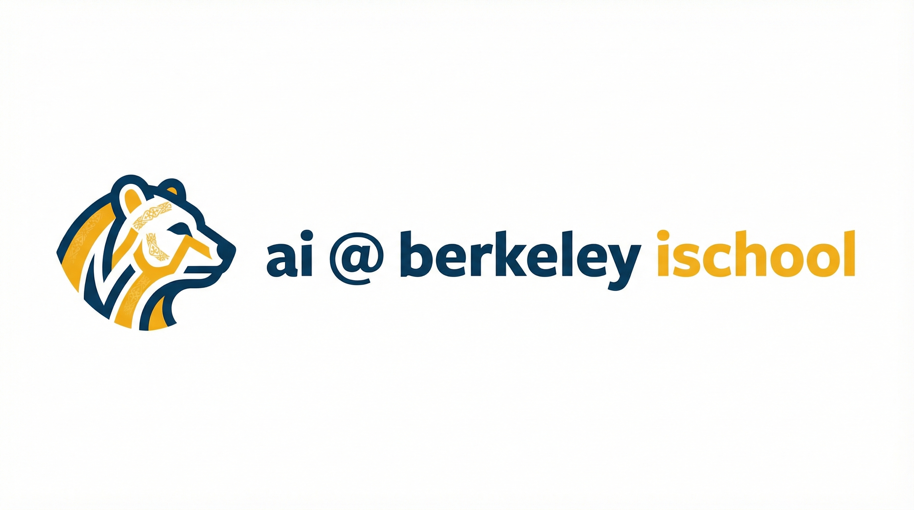

<p align="center">
  
</p>

# Sub-3B Function-Calling SLM

A function-calling small language model that pushes the sub-3B parameter
frontier on the Berkeley Function Calling Leaderboard V4. Built on
Qwen2.5-3B-Instruct with QLoRA, GRPO, and Hammer-style function masking.

UC Berkeley, INFO 290 - Fundamentals of Generative AI (Spring 2026).
**Team:** Arnur Sabet, Assel Sakenkyzy, Diara Bagayeva, Meruyert Tastybay.

## Approach

Six variants isolate the contribution of each technique against a
zero-shot baseline:

| ID | Variant                       | SFT | GRPO | Masking | Curriculum |
|----|-------------------------------|-----|------|---------|------------|
| V1 | Base, zero-shot               | -   | -    | -       | -          |
| V2 | SFT, unmasked                 | x   | -    | -       | -          |
| V3 | SFT + masking                 | x   | -    | x       | -          |
| V4 | GRPO cold-start, unmasked     | -   | x    | -       | -          |
| V5 | GRPO + masking                | -   | x    | x       | -          |
| V6 | Full recipe (stretch)         | -   | x    | x       | x          |

Training data is a 4,000-example curated subset of
[Salesforce/xLAM-function-calling-60k](https://huggingface.co/datasets/Salesforce/xlam-function-calling-60k),
filtered for validity, deduplicated, balanced for single/parallel-call
mix, and scored for parameter-type diversity. 67% of examples receive
Hammer-style function masking to encourage reading natural-language
tool descriptions over name memorization.

## Use the model

```python
from peft import PeftModel
from transformers import AutoModelForCausalLM, AutoTokenizer

base = AutoModelForCausalLM.from_pretrained("Qwen/Qwen2.5-3B-Instruct", device_map="auto")
tokenizer = AutoTokenizer.from_pretrained("Qwen/Qwen2.5-3B-Instruct")
model = PeftModel.from_pretrained(base, "arnursb/info290-function-calling-slm-3b")
```

For OpenAI-compatible serving, see [`src/serving/`](src/serving/) - a
vLLM scaffold with LoRA support.

## Reproduce

The notebooks under [`notebooks/`](notebooks/) are designed for Colab
with GPU and mirror each pipeline stage:

- `bfcl_smoke_test.ipynb` - minimal end-to-end smoke test
- `sft_training.ipynb` - V2 / V3 supervised fine-tuning
- `grpo_training.ipynb` - V4 / V5 / V6 reinforcement learning
- `full_evaluation.ipynb` - BFCL V4 across all variants

Local Python 3.12 setup:

```bash
pip install -r requirements.txt
huggingface-cli login    # accept Salesforce/xlam-function-calling-60k terms
```

Decoding config and BFCL settings live in [`configs/`](configs/).
Training scripts refuse to start without `HF_TOKEN` and `HF_REPO_ID`.

## Systems contributions

Three reproducibility bugs in upstream `bfcl-eval` were patched in
[our fork](https://github.com/arnursabet/gorilla/tree/qwen-2.5-3b-handler-t4-support)
and pinned in `requirements.txt`:

1. **Silent dtype kwarg.** `QwenFCHandler.__init__` declared `dtype`
   but never forwarded it to `super().__init__()`. T4 silently failed
   under the bf16 default.
2. **Hardcoded vLLM args.** Added `BFCL_VLLM_MAX_NUM_SEQS` and
   `BFCL_VLLM_MAX_MODEL_LEN` env knobs so memory-constrained GPUs no
   longer OOM on the upstream `max_num_seqs=256` default.
3. **Context-length desync.** Synced `leftover_tokens_count` cap to
   the actual `--max-model-len` set by the env var.

## License

Apache 2.0.
