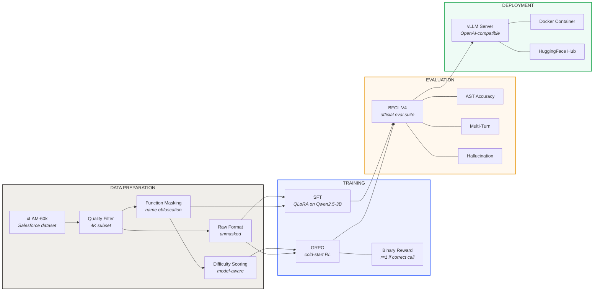
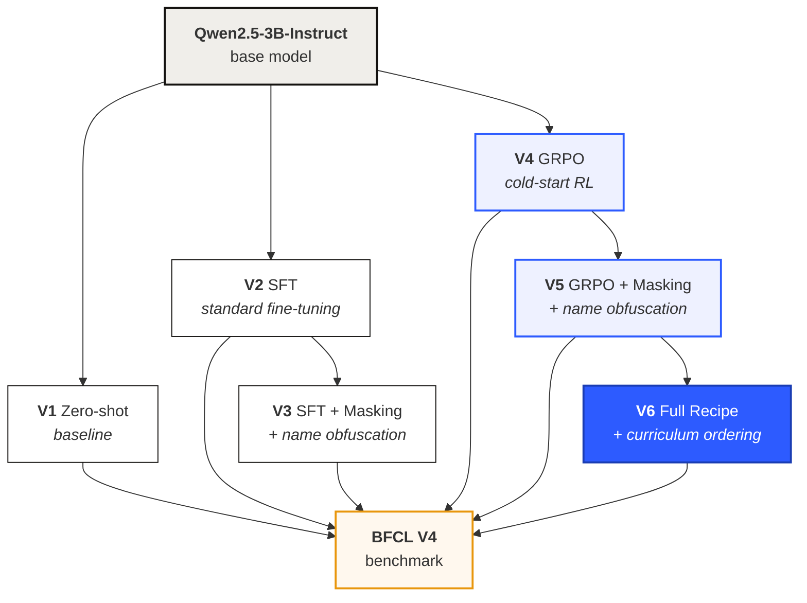

# Pushing the Sub-3B Frontier for Function-Calling SLMs

**Team Members:**

- Arnur Sabet (sabet@berkeley.edu)
- Assel Sakenkyzy (assel_sakenkyzy@berkeley.edu)
- Diara Bagayeva (diarabagayeva@berkeley.edu)
- Meruyert Tastybay (meruyert_tastybay@berkeley.edu)

**GitHub Repository:** https://github.com/arnursabet/info290-function-calling-slm

## Project Description

Function calling is the core capability that separates chatbots from AI agents. When an agent needs to check the weather, book a flight, or query a database, it doesn't answer directly. Instead, it outputs a structured function call with the correct tool name and parameters. Today, reliable function calling requires large proprietary models like GPT-4, which cost roughly $0.03 per call and introduce 1-2 seconds of latency. For agentic systems that make hundreds of tool calls per task, this adds up fast.

Recent work has shown that small language models (SLMs) can be trained for function calling, but performance drops sharply below 7 billion parameters. On the Berkeley Function Calling Leaderboard (BFCL V4), sub-3B models score 20-40% on complex multi-turn and agentic tasks, compared to 85%+ for state-of-the-art 7B models. But real-world deployment (edge devices, browser-based agents, cost-sensitive applications at scale) often requires models much smaller than 7B.

Our project combines three techniques from the 2025-2026 literature that have individually shown strong results but have never been combined at the sub-3B scale:

**GRPO reinforcement learning** (from NVIDIA's Nemotron-Tool-N1 and ToolRL): Training with a binary reward signal (correct function call = 1, incorrect = 0) rather than supervised fine-tuning. Multiple papers show cold-start GRPO outperforms SFT and even SFT-then-RL pipelines, because SFT initialization can cause memorization that limits exploration.

**Function masking** (from Hammer 2.1, ICLR 2025): During training, function names and parameter names are replaced with random strings. This forces the model to reason from natural language descriptions rather than memorizing naming conventions, improving generalization to unseen APIs.

**Curriculum training** (inspired by ToolACE-R): Ordering training examples from simple single-turn calls to complex parallel and multi-turn scenarios, using model-aware difficulty scoring.

We will train six system variants on Qwen2.5-3B-Instruct using a 4K-example subset of the xLAM-function-calling-60k dataset (Salesforce, CC-BY-4.0). Each variant adds one technique incrementally: (1) base zero-shot, (2) SFT only, (3) SFT + masking, (4) GRPO cold-start, (5) GRPO + masking, (6) GRPO + masking + curriculum. This design isolates the contribution of each technique.

We evaluate all variants on BFCL V4, which weights agentic tasks (40%), multi-turn (30%), live scenarios (10%), non-live (10%), and hallucination detection (10%). Our target is to exceed Hammer2.1-3B (~68%) on the overall benchmark. We also measure latency and compute cost per call to quantify the practical deployment tradeoff against GPT-4.

We also deliver a full MLOps pipeline: data generation and versioning with DVC, experiment tracking with Weights & Biases, an OpenAI-compatible inference server (vLLM + FastAPI in Docker), and CI/CD via GitHub Actions. The best model will be published on HuggingFace so any developer building an agent can swap in our 3B model as a drop-in replacement for GPT-4 tool calls.

## Related Work

The most relevant prior work is NVIDIA's Nemotron-Research-Tool-N1 (May 2025), which demonstrated that pure GRPO outperforms SFT for function calling at 7B+ scale. RC-GRPO (February 2026) extended this with reward-conditioned training, achieving 85% on BFCL V4 multi-turn with a 7B model, surpassing all closed-source models. Hammer 2.1 (ICLR 2025) introduced function masking and showed strong generalization at sizes from 0.5B to 7B, but used SFT rather than RL. Our project differs by combining GRPO with function masking at the 3B scale, which no existing work has attempted, and by adding curriculum-based training ordering.

## Data Sources

- **Training data:** xLAM-function-calling-60k (Salesforce, CC-BY-4.0 license) - https://huggingface.co/datasets/Salesforce/xlam-function-calling-60k
- **Evaluation:** Berkeley Function Calling Leaderboard V4 (BFCL) - https://gorilla.cs.berkeley.edu/leaderboard.html
- **Base model:** Qwen2.5-3B-Instruct (Apache 2.0) - https://huggingface.co/Qwen/Qwen2.5-3B-Instruct

## System Design

Our system takes a user query and a list of available tool definitions (JSON schemas) and produces structured function calls (tool name + parameters). The architecture is a single fine-tuned Qwen2.5-3B model served via vLLM with an OpenAI-compatible API endpoint.

### Training Pipeline

### Experimental Design

### Implementation Details

Training uses QLoRA for SFT variants and the TRL library's GRPO implementation for RL variants. GRPO uses a binary reward (correct call = 1, else 0) with a format reward requiring proper XML tags. All experiments run on Google Colab Pro (A100 GPU).

Evaluation uses the official BFCL evaluation suite with AST-based accuracy for non-live tasks, state-based checking for multi-turn, and LLM-as-judge for ambiguous cases. We report overall score, per-category breakdown, latency, and cost per 1M calls.
